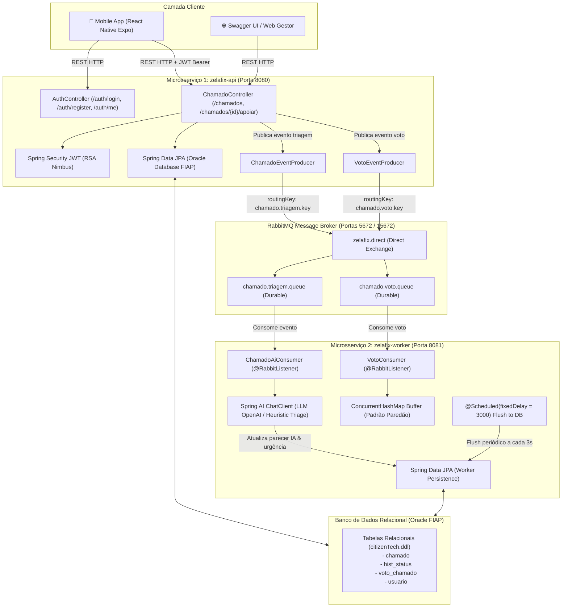

# 🏙️ ZelaFix Backend — Microsserviços e Mensageria Assíncrona com RabbitMQ & Spring AI
> **FIAP — Global Solution 2026/2 | CitizenTech & Cidades Sustentáveis (ODS 11)**  
> **Disciplina:** Java Advanced  
> **Opção Distribuída Escolhida:** **Opção A — Mensageria Assíncrona com RabbitMQ** (Padrão Projeto *Paredão*)

---

## 👥 Integrantes do Grupo

| RM | Nome Completo | Turma |
| :---: | :--- | :---: |
| **RM554744** | Enzo De Oliveira Silva | 2TDSS |
| **RM554904** | Lucca de Gouveia | 2TDSS |
| **RM554707** | Marcos Vinicius | 2TDSS |

---

## 🏛️ 1. Arquitetura Distribuída do Sistema

O backend foi arquitetado em **dois microsserviços autônomos e desacoplados** que se comunicam de forma assíncrona através de mensageria com **RabbitMQ**:

1. **`zelafix-api` (Gateway REST & Produtor — Porta 8080):**
   - API RESTful do domínio consumida pelo aplicativo mobile (**React Native Expo**) e painel web administrativo.
   - Autenticação e autorização via **Spring Security com tokens Bearer JWT assinados por par de chaves RSA**.
   - Mapeamento relacional com **Spring Data JPA** e paginação (`Pageable`) sobre o schema corporativo Oracle (`citizenTech.ddl`).
   - Validações de entrada com **Jakarta Bean Validation** (`@Valid`) e tratamento centralizado de exceções (`@RestControllerAdvice`).
   - **Produtor RabbitMQ:** Publica eventos de abertura de ocorrências (`chamado.triagem.key`) e votos/apoios da comunidade (`chamado.voto.key`).

2. **`zelafix-worker` (Consumidor Assíncrono & Heavy Worker — Porta 8081):**
   - Microsserviço de processamento em segundo plano sem exposição de endpoints públicos.
   - **Triagem Inteligente via Spring AI:** Escuta a fila `chamado.triagem.queue`, aciona a LLM da OpenAI para classificação de urgência, identificação de órgão municipal competente e emissão de parecer técnico fundamentado.
   - **Agregador de Votos (`VoteConsumer`):** Escuta a fila `chamado.voto.queue`, acumula os votos em memória utilizando `ConcurrentHashMap` thread-safe para suportar picos de tráfego sem sobrecarregar o banco, e descarrega os totais em lote a cada 3 segundos com `@Scheduled(fixedDelay = 3000) flush()`.



---

## 📊 2. Tabela de Conformidade com os Critérios da Global Solution (100 pts)

| Item | Critério de Avaliação | Pontos | Como Foi Atendido no Projeto |
| :---: | :--- | :---: | :--- |
| **01** | **API REST do Domínio** (mínimo 3 entidades relacionadas, CRUD e paginação) | **20 pts** | Mapeamento relacional de 10 entidades conforme `citizenTech.ddl` (`Usuario`, `Chamado`, `Categoria`, `Status`, `VotoChamado`, `HistChamado`, `Endereco`, `Bairro`, `Cidade`, `Estado`). Suporte a paginação com `Pageable`, ordenação dinâmica e filtros por status, categoria e busca textual. |
| **02** | **Validação & Tratamento de Erros** (`@Valid` e `@RestControllerAdvice`) | **10 pts** | Bean Validation estrito em todos os DTOs (`@NotBlank`, `@Email`, `@Size`, etc.). `GlobalExceptionHandler` captura `MethodArgumentNotValidException`, `ResourceNotFoundException` e `BadCredentialsException` retornando `ProblemDetail` padronizado (RFC 7807). |
| **03** | **Segurança com JWT & RBAC** (múltiplos papéis de usuário) | **20 pts** | Spring Security 6 / OAuth2 Resource Server com tokens JWT assinados via par de chaves RSA 2048 bits geradas automaticamente pelo Gradle. Controle de acesso por papéis: `ROLE_CIDADAO` (munícipe: criar ocorrências, apoiar com votos, gerenciar próprio perfil), `ROLE_GESTOR` (agente da prefeitura: avaliar ocorrências e atualizar status de resolução dos chamados) e `ROLE_ADMIN` (administrador geral com CRUD completo de usuários, chamados, categorias, status, endereços e alteração de cargos). |
| **04** | **Spring AI Integrado ao Fluxo de Negócio** | **20 pts** | Integração via `ChatClient` com OpenAI (modelo `gpt-4o-mini`) no `zelafix-worker`. O worker consome a mensagem da fila assíncrona, analisa a criticidade do chamado, classifica o órgão municipal competente e emite parecer técnico fundamentado para a equipe de campo, com fallback heurístico para execução offline. |
| **05** | **Arquitetura Distribuída Funcional (Opção A — RabbitMQ)** | **20 pts** | Implementação com 2 microsserviços autônomos (`zelafix-api` e `zelafix-worker`). Mensageria com RabbitMQ: DirectExchange `zelafix.direct`, filas duráveis e agregação de votos com buffer em memória (`ConcurrentHashMap`) e flush periódico em lote (`@Scheduled`). |
| **06** | **Documentação OpenAPI/Swagger & Integração Mobile** | **10 pts** | Swagger interativo disponível em `http://localhost:8080/swagger-ui.html`. Integração 100% validada com o app React Native (`Mobile-Application-Development`), com rotas diretas padronizadas (`/chamados`, `/usuarios`, `/auth/login`, etc.). |
| **TOTAL** | **Pontuação Total da Entrega** | **100 pts** | **Solução Completa, Testada e Validada.** |

---

## 🔑 3. Credenciais de Teste para Avaliação

O banco de dados é inicializado automaticamente com usuários de teste e dados pré-carregados via migrations versionadas do Flyway (`V1__criar_tabelas_zelafix.sql`, `V2__dados_iniciais_zelafix.sql` e `V3__admin_inicial.sql`):

| Papel | Nome | E-mail | Senha | Permissões |
| :--- | :--- | :--- | :--- | :--- |
| **Cidadão** | Carlos Munícipe | `cidadao@zelafix.com.br` | `Senha@123` | Criar chamados (iniciam como `PENDENTE`), apoiar ocorrências e gerenciar seu perfil. |
| **Funcionário da Prefeitura** | Mariana Servidora Pública | `gestor@zelafix.com.br` | `Senha@123` | Agente público da prefeitura: atualizar status de resolução dos chamados (`PENDENTE`, `EM_ANALISE`, `EM_EXECUCAO`, `CONCLUIDO`, `REJEITADO`). |
| **Administrador Geral** | Administrador ZelaFix | `admin@zelafix.com.br` | `123mudar` | Acesso administrativo irrestrito: CRUD completo de usuários, chamados, categorias, status, endereços e alteração de perfis/cargos. |

---

## 🚀 4. Guia de Execução Local

### Pré-requisitos
- **Java 25** (Amazon Corretto 25 configurado no sistema).
- **Docker & Docker Compose** (para subir o RabbitMQ).

### Passo 1: Subir o Broker de Mensageria (RabbitMQ)
Na raiz do diretório `Java-Advanced`, execute:
```bash
docker compose up -d
```
- O painel web de gestão do RabbitMQ estará acessível em: `http://localhost:15672` (login: `guest` / senha: `guest`).

### Passo 2: Executar o Microsserviço 1 (zelafix-api — Porta 8080)
Em um terminal:
```bash
# A partir da raiz de Java-Advanced
.\gradlew :zelafix-api:bootRun
```
- A API REST estará rodando em: `http://localhost:8080`
- Swagger UI interativo: `http://localhost:8080/swagger-ui.html`
- Banco de Dados Conectado: Oracle FIAP (`oracle.fiap.com.br:1521/orcl`)

### Passo 3: Executar o Microsserviço 2 (zelafix-worker — Porta 8081)
Em outro terminal:
```bash
# A partir da raiz de Java-Advanced
.\gradlew :zelafix-worker:bootRun
```
- O worker conectará automaticamente ao RabbitMQ e à base de dados para processar a triagem por IA e agregação de votos.

---

## 🧪 5. Execução dos Testes Automatizados

Para rodar todos os testes unitários e de integração de ambos os microsserviços:
```bash
cd c:\Users\Enzo\new_backup\FIAP\_Projetos\Global_Solution_2\Java-Advanced
.\gradlew test
```
Ou individualmente:
```bash
.\gradlew :zelafix-api:test
.\gradlew :zelafix-worker:test
```

---

## 📱 6. Integração com o App Mobile (React Native Expo)

O app mobile em `Mobile-Application-Development` conecta-se diretamente à `zelafix-api`:
- **Android Emulator:** `http://10.0.2.2:8080/api`
- **iOS Simulator / Web:** `http://localhost:8080/api`

Todos os contratos de resposta foram alinhados para retornar o objeto atualizado do chamado em operações de apoio/voto (`POST /chamados/{id}/apoiar`), listas paginadas (`content[]`), autenticação JWT com persistência no SecureStore/AsyncStorage e visualização das fotos.

---

## 🤖 7. Declaração Obrigatória de Uso de IA Generativa

Em total conformidade com as diretrizes do regulamento da Global Solution 2026/2:
- **Ferramentas utilizadas:** Google Antigravity / Gemini 2.5 Flash / Claude 3.5 Sonnet no auxílio ao design arquitetural, estruturação do build Gradle multi-project e geração de testes unitários.
- **Spring AI:** O microsserviço `zelafix-worker` utiliza a biblioteca oficial `spring-ai-starter-model-openai` (Spring AI 2.0.1) consumindo modelos LLM para a triagem automatizada, classificação de urgência e parecer técnico em favor do cidadão e da gestão pública.
