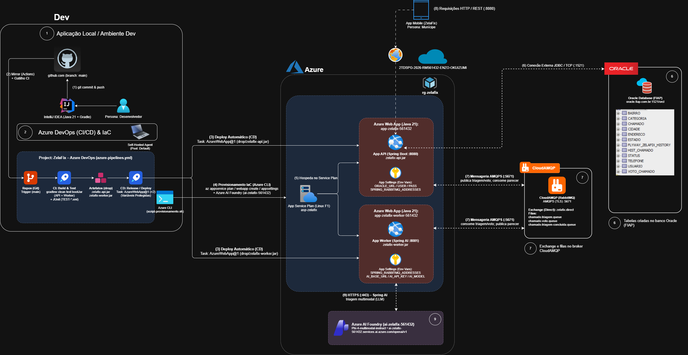

# 🏙️ ZelaFix Backend — Microsserviços e Mensageria Assíncrona com RabbitMQ & Spring AI
> **FIAP — Global Solution 2026/2 | CitizenTech & Cidades Sustentáveis (ODS 11)**  
> **Disciplina:** Java Advanced  
> **Opção Distribuída Escolhida:** **Opção A — Mensageria Assíncrona com RabbitMQ** (Padrão de Arquitetura Distribuída Reativa)  
> **Deploy em Nuvem:** Azure Web Apps (Linux) via Esteira Automatizada CI/CD Azure DevOps

| Link Rápido | URL |
|---|---|
| **Repositório GitHub (Java)** | https://github.com/Global-Solution-CitizenTech/Java-Advanced |
| **Repositório GitHub (DevOps)** | https://github.com/Global-Solution-CitizenTech/DevOps-Tools-Cloud-Computing |
| **Projeto no Azure DevOps** | https://dev.azure.com/ZelaFixGS/ZelaFix |
| **API em Produção (Azure Web App)** | https://app-zelafix-561432.azurewebsites.net |
| **Worker IA em Produção (Azure Web App)** | https://app-zelafix-worker-561432.azurewebsites.net |
| **Swagger UI Interativo (Produção)** | https://app-zelafix-561432.azurewebsites.net/swagger-ui.html |
| **OpenAPI Docs JSON (Produção)** | https://app-zelafix-561432.azurewebsites.net/v3/api-docs |
| **Actuator Health API (Produção)** | https://app-zelafix-561432.azurewebsites.net/actuator/health |
| **Actuator Health Worker (Produção)** | https://app-zelafix-worker-561432.azurewebsites.net/actuator/health |
| **Swagger UI (Local)** | http://localhost:8080/swagger-ui.html |
| **Coleção Oficial de Automação (Postman QA)** | https://github.com/Global-Solution-CitizenTech/Compliance-Quality-Assurance-Tests |

## 🔗 Vídeo Pitch e Demonstração (Global Solution 2)

* **Vídeo Pitch (até 5 min):** *(Link do YouTube será inserido após gravação)*
* **Vídeo de Demonstração Técnica:** *(Link do YouTube será inserido após gravação)*

---

## 👥 Integrantes do Grupo

| RM | Nome Completo | Turma |
| :---: | :--- | :---: |
| **RM561432** | Enzo Okuizumi Miranda de Souza | 2TDSPG |
| **RM563428** | Gustavo Keiji Okada | 2TDSPG |
| **RM566422** | Lucas Barros Gouveia | 2TDSPG |
| **RM562290** | Luna de Carvalho Guimarães | 2TDSPG |
| **RM564836** | Milton Jakson de Sousa Marcelino | 2TDSPG |

---

## 📂 1. Estrutura do Repositório & Arquitetura Gradle Multi-Project

### Por que adotamos Gradle Multi-Project? *(Justificativa Técnica Corporativa)*
> *"Adotamos a arquitetura de **Gradle Multi-Project**, que é a boa prática corporativa para microsserviços que compartilham o mesmo ecossistema e ciclo de release. Ela nos permite ter controle centralizado das versões do Spring Boot (4.1.1), Java (21 LTS) e repositórios Maven, compilar e testar toda a esteira de CI/CD de forma atômica no Azure DevOps em um único comando (`call gradlew.bat clean test bootJar`), e ao mesmo tempo manter `zelafix-api` e `zelafix-worker` como artefatos completamente desacoplados, independentes e isolados em tempo de execução."*

### Árvore de Diretórios do Projeto
```text
Java-Advanced/
├── .github/
│   └── workflows/
│       └── mirror-to-azure.yml      # Espelhamento automático GitHub ↔ Azure Repos
├── azure-pipelines.yml               # Pipeline unificado de CI/CD (Azure DevOps)
├── build.gradle                      # Gradle root: controle centralizado de plugins
├── settings.gradle                   # Declaração dos submódulos: zelafix-api e zelafix-worker
├── gradle.properties                 # Configurações de JVM e encoding UTF-8
├── gradlew / gradlew.bat             # Gradle Wrapper corporativo (Gradle 8.10)
├── AGENT.md                          # Guia operacional da arquitetura e convenções
│
├── zelafix-api/                      # MICROSSERVIÇO 1: Gateway REST & Persistência
│   ├── Dockerfile                    # Multi-stage build (Temurin 21 JRE Alpine, non-root)
│   ├── build.gradle                  # Dependências JPA, Oracle, Flyway, Security, RabbitMQ
│   └── src/
│       ├── main/
│       │   ├── java/fiap/com/br/zelafix/
│       │   │   ├── auth/             # Autenticação JWT RSA, Login & UserDetailsService
│       │   │   ├── usuario/          # Gestão de munícipes e perfis (Cidadão, Gestor, Admin)
│       │   │   ├── chamado/          # Ocorrências urbanas (Chamado, dto/, prioridade/, orgao/)
│       │   │   ├── categoria/        # Catálogo com cache declarativo (@Cacheable)
│       │   │   ├── status/           # Máquina de estados de resolução das ocorrências
│       │   │   ├── endereco/         # Normalização geográfica e integração ViaCEP
│       │   │   ├── historico/        # Auditoria de transições dos chamados (HistChamado)
│       │   │   ├── voto/             # Controle de apoio comunitário (VotoChamado)
│       │   │   ├── queue/            # Produtores RabbitMQ e Feedback Consumer da IA
│       │   │   ├── config/           # SecurityConfig, RabbitConfig, RestClientConfig
│       │   │   └── exception/        # GlobalExceptionHandler RFC 7807
│       │   └── resources/
│       │       ├── application.properties
│       │       └── db/migration/     # Flyway V1 (DDL), V2 (Domínios Base + Admin), V3 (Dados Iniciais)
│       └── test/                     # Testes unitários, E2E da IA (src/test/e2e/) e suíte Python em tests/
│
└── zelafix-worker/                   # MICROSSERVIÇO 2: Worker Reativo Stateless
    ├── Dockerfile                    # Multi-stage build leve (sem JDBC/JPA, non-root)
    ├── build.gradle                  # Dependências Spring AMQP e Spring AI (Azure AI Foundry)
    └── src/
        ├── main/
        │   ├── java/fiap/com/br/zelafix/worker/
        │   │   ├── ai/               # ZelaFixAiService, dto/TriagemIaResult, enums/ e util/ (Magic Bytes)
        │   │   ├── consumer/         # ChamadoAiConsumer & VotoConsumer (@RabbitListener)
        │   │   ├── queue/            # DTOs de mensageria (ChamadoTriagemMessage, TriagemFeedbackMessage)
        │   │   └── config/           # RabbitWorkerConfig
        │   └── resources/
        │       └── application.properties
        └── test/                     # Suíte de testes unitários do consumidor de IA e RabbitMQ
```
---

## ☁️ 6. Arquitetura em Nuvem & Esteira CI/CD (Azure DevOps & App Services)

<p align="center">
  
</p>

---

## 🏛️ 2. Arquitetura Distribuída Reativa e Divisão de Responsabilidades

O ecossistema **ZelaFix** é operado por **dois microsserviços especializados** interligados por mensageria com **RabbitMQ**:

```
                              ┌──────────────────────────────────────────────┐
                              │            Client Layer (Mobile/Web)         │
                              └──────────────────────┬───────────────────────┘
                                                     │ HTTP REST / JWT Bearer (RSA)
                                                     ▼
┌────────────────────────────────────────────────────────────────────────────────────────────────────────┐
│  zelafix-api (Porta 8080) — Gateway RESTful de Domínio & Persistência ACID                             │
│  - Spring Security 6 com JWT RSA (Nimbus) & RBAC (ROLE_CIDADAO, ROLE_GESTOR, ROLE_ADMIN)               │
│  - Persistência exclusiva no Banco Relacional Oracle FIAP via Spring Data JPA                          │
│  - Versionamento de banco automático com Flyway Migrations (V1 DDL, V2 Domínios + Admin, V3 Seed)      │
│  - Cache declarativo de catálogo com @Cacheable/@CacheEvict (Categoria, Status, Prioridade, Órgão)     │
│  - Cliente declarativo HTTP com timeouts e resiliência (ViaCepService)                                 │
│  - Produtor RabbitMQ: cria ocorrência (endereço + foto) e publica bytes da foto no zelafix.direct      │
│  - Consumidor RabbitMQ (Feedback): consome triagem da IA e preenche título, descrição, cat/prio/órgão  │
└───────────────────────┬────────────────────────────────────────────────────▲───────────────────────────┘
                        │                                                    │
                        │ chamado.triagem.key                                │ chamado.triagem-concluida.key
                        │ chamado.voto.key                                   │
                        ▼                                                    │
┌────────────────────────────────────────────────────────────────────────────┴───────────────────────────┐
│  RabbitMQ Broker (Porta 5672) — Exchange: zelafix.direct (DirectExchange)                              │
│  - Fila: chamado.triagem.queue (Durable)                                                               │
│  - Fila: chamado.triagem-concluida.queue (Durable)                                                     │
│  - Fila: chamado.voto.queue (Durable)                                                                  │
└───────────────────────┬────────────────────────────────────────────────────────────────────────────────┘
                        │
                        │ Consumo Assíncrono
                        ▼
┌────────────────────────────────────────────────────────────────────────────────────────────────────────┐
│  zelafix-worker (Porta 8081) — Stateless Heavy Worker                                                  │
│  - Consumidor assíncrono de alta vazão (RabbitMQ @RabbitListener)                                      │
│  - Inteligência Artificial Generativa e Multimodal com Spring AI (Azure AI Foundry / Phi-4 Multimodal) │
│  - Detecção dinâmica de MIME type via magic bytes (ImageMimeTypeDetector)                              │
│  - Agregador de votos em buffer volátil thread-safe (ConcurrentHashMap com flush periódico a cada 3s)  │
│  - 100% Stateless: ZERO CONEXÃO COM BANCO DE DADOS (sem JDBC, sem JPA, sem Oracle, sem locks)          │
│  - Produtor de retorno: publica parecer técnico estruturado em chamado.triagem-concluida.queue         │
└────────────────────────────────────────────────────────────────────────────────────────────────────────┘
```

---

## 🚫 3. Desacoplamento Radical: Por que o Worker NÃO acessa o Banco?

A ausência total de dependências JPA/JDBC e conexões de banco de dados no `zelafix-worker` é um diferencial arquitetural sênior:

1. **Isolamento de Falhas e Resiliência:** O worker atua como um *pure inference worker*. Lentidões ou indisponibilidades temporárias do banco de dados não afetam o consumo da IA nem saturam o pool de conexões (HikariCP).
2. **Escalabilidade Horizontal Instantânea:** Instâncias do worker sobem em ~2 segundos e podem ser multiplicadas elasticamente sem disputar o limite de conexões simultâneas do Oracle corporativo.
3. **Padrão de Feedback Assíncrono:** Na criação do chamado (`POST /chamados` JSON com `ChamadoCreateRequest` ou `multipart/form-data` com `dados` + `foto`), o cidadão envia apenas endereço e evidência fotográfica, recebendo protocolo imediato com título/descrição pendentes enquanto a foto segue para a fila. O worker analisa a imagem e devolve `TriagemFeedbackMessage` para `chamado.triagem-concluida.queue`. A `zelafix-api`, única detentora do schema relacional, consome o feedback via `ChamadoTriagemFeedbackConsumer` e atualiza título, descrição, categoria, prioridade e órgão competente em transação ACID.
4. **Absorção de Rajadas de Votos (Padrão Paredão):** O `VotoConsumer` acumula apoios em memória com `ConcurrentHashMap<Long, Integer>`. O flush periódico a cada 3 segundos (`@Scheduled`) consolida os lotes em log e libera a memória, sem estressar o banco relacional.

---

## 🔄 4. Topologia e Fluxo de Mensageria RabbitMQ (`zelafix.direct`)

Toda a comunicação assíncrona entre os dois serviços é orquestrada pela `DirectExchange` nomeada `zelafix.direct`:

| Fila | Routing Key | Produtor | Consumidor | Payload | Finalidade |
| :--- | :--- | :--- | :--- | :--- | :--- |
| `chamado.triagem.queue` | `chamado.triagem.key` | `zelafix-api` | `zelafix-worker` | `ChamadoTriagemMessage` | Dispara a triagem multimodal com Spring AI transportando os bytes da foto. |
| `chamado.triagem-concluida.queue` | `chamado.triagem-concluida.key` | `zelafix-worker` | `zelafix-api` | `TriagemFeedbackMessage` | Devolve título, descrição, categoria, prioridade e órgão para persistência JPA. |
| `chamado.voto.queue` | `chamado.voto.key` | `zelafix-api` | `zelafix-worker` | `VotoMessage` | Notifica apoios/votos em ocorrências para agregação de alta vazão em memória. |

- **Serialização Padronizada:** Mensagens trafegam como JSON canônico (UTF-8) com `JacksonJsonMessageConverter`, eliminando dependências frágeis de `java.io.Serializable`.

---

## 🧠 5. Triagem Inteligente Multimodal com Spring AI (`ZelaFixAiService`)

Toda ocorrência registrada na plataforma exige foto comprobatória (`BLOB NOT NULL` no banco de dados):

- **Injeção Idiomática do `ChatClient`:** Configurado com `SYSTEM_PROMPT` técnico e `SimpleLoggerAdvisor` para observabilidade de prompts no console.
- **Detecção de MIME Type por Magic Bytes (`ImageMimeTypeDetector`):** Analisa a assinatura binária dos primeiros bytes (`image/jpeg`, `image/png`, `image/webp`, `image/gif`) para anexar dinamicamente como `ByteArrayResource` no prompt multimodal.
- **Structured Output Tipado:** O retorno do LLM é automaticamente serializado para o record `TriagemIaResult`:
  ```java
  public record TriagemIaResult(
      String titulo,                        // Título curto e objetivo da ocorrência (até 100 caracteres)
      String descricao,                     // Descrição técnica detalhada e riscos (até 1000 caracteres)
      CategoriaSugerida categoriaSugerida,  // Categoria oficial da zeladoria urbana
      PrioridadeChamado prioridade,         // BAIXA, MEDIA, ALTA, URGENTE
      DepartamentoGoverno orgaoResponsavel  // Subprefeitura Regional, CET, SABESP, Enel, Defesa Civil, etc.
  ) {}
  ```

---

## 🐳 7. Containerização com Docker (Multi-Stage Build)

Ambos os microsserviços utilizam **Dockerfiles multi-stage build** otimizados para produção:
- **Build Stage:** `gradle:8.10-jdk21-alpine` (compilação sem daemon e geração de chaves RSA para JWT via OpenSSL).
- **Runtime Stage:** `eclipse-temurin:21-jre-alpine` (imagem base ultraleve de produção).
- **Segurança:** Execução obrigatória com usuário não-root (`appuser:appgroup`).
- **Timezone:** Configurado para `America/Sao_Paulo` (garante integridade de auditoria com o Oracle).

### Comandos de Build e Execução Docker (a partir da raiz `Java-Advanced/`)
```bash
# 1. Build da imagem da API
docker build -f zelafix-api/Dockerfile -t zelafix-api:latest .

# 2. Build da imagem do Worker
docker build -f zelafix-worker/Dockerfile -t zelafix-worker:latest .

# 3. Execução dos containers injetando variáveis de ambiente
docker run -d -p 8080:8080 --env-file .env --name zelafix-api zelafix-api:latest
docker run -d -p 8081:8081 --env-file .env --name zelafix-worker zelafix-worker:latest
```

---

## 🔑 8. Credenciais de Teste

O banco de dados Oracle é inicializado automaticamente com usuários de teste via migrations do Flyway:

| Papel | Nome | E-mail | Senha | Permissões |
| :--- | :--- | :--- | :--- | :--- |
| **Cidadão** | Enzo Okuizumi | `enzo.okuizumi@gmail.com` | `123mudar` | Criar ocorrências com foto + endereço, apoiar com votos, editar próprios dados e consultar histórico. |
| **Gestor Público** | Eng. Roberto Santos | `roberto.gestor@subprefeitura.sp.gov.br` | `Senha#123` | Agente público: atualizar status dos chamados (`PENDENTE`, `ABERTO`, `EM_ANALISE`, `EM_EXECUCAO`, `CONCLUIDO`, `REJEITADO`). |
| **Gestor Público** | Coordenador Lucas Mendes | `lucas.zeladoria@subprefeitura.sp.gov.br` | `Senha#123` | Agente público: acompanhar triagens, atualizar status e registrar observações técnicas. |
| **Administrador Geral** | Administrador Geral | `admin@zelafix.com.br` | Configurada via `${ADMIN_BCRYPT_HASH}` (`123mudar` em `.env.example`) | Acesso irrestrito: CRUD de usuários, chamados, categorias, status, endereços e alteração de perfis. |

---

## 🚀 9. Guia de Execução Local

### Pré-requisitos
- **Java 21 LTS** (Amazon Corretto ou Eclipse Temurin 21).
- Arquivo `.env` configurado na raiz de `Java-Advanced` (baseado em `.env.example`), apontando para o Oracle FIAP, **RabbitMQ (CloudAMQP)** (`SPRING_RABBITMQ_ADDRESSES`) e **Azure AI Foundry** (`AI_BASE_URL`, `AI_API_KEY`, `AI_MODEL`).

### Executando localmente via Gradle
```bash
# Terminal 1 — Iniciar a API REST (Porta 8080)
.\gradlew :zelafix-api:bootRun

# Terminal 2 — Iniciar o Worker Reativo (Porta 8081)
.\gradlew :zelafix-worker:bootRun
```

### Executando os Testes Automatizados
```bash
# Executar todos os testes de ambos os módulos
.\gradlew test

# Executar testes individualmente por módulo
.\gradlew :zelafix-api:test
.\gradlew :zelafix-worker:test
```
